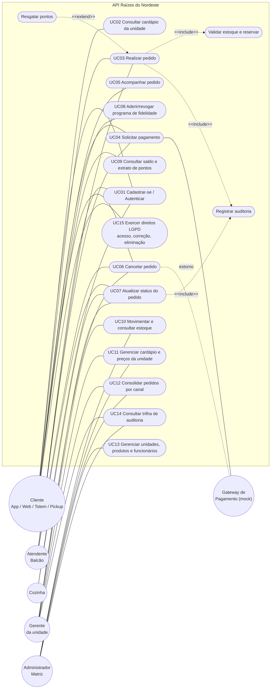

# Diagrama de Casos de Uso

Atores: cliente (app, web, totem, pickup), atendente (balcão), cozinha, gerente, administrador da matriz e o gateway de pagamento (sistema externo, simulado).

Também tem uma versão em PlantUML no arquivo 01-casos-de-uso.puml, que fica melhor para colocar no PDF.

## Descrição do caso de uso principal: Realizar pedido e pagar

Atores: cliente (app, totem, web ou pickup) ou atendente (balcão). O gateway de pagamento participa como sistema externo.

Pré-condições: o usuário está logado, a unidade está ativa e os produtos estão no cardápio da unidade.

Pós-condições: o pedido fica salvo com o canal, os itens e o total, o estoque é baixado, o pagamento é registrado com a resposta do gateway e o pedido fica como PAGO. Se o cliente participa do programa de pontos, os pontos são creditados. Tudo fica registrado na auditoria.

Fluxo principal:

1. O cliente envia o pedido com canal, unidade, itens e forma de pagamento.
2. O sistema valida os dados e confere se aquele perfil pode usar aquele canal (o balcão é só para funcionários).
3. O sistema confere se a unidade existe e se os produtos estão no cardápio dela.
4. O sistema confere o estoque de cada item.
5. O sistema calcula o total, já com o desconto de pontos, se tiver.
6. O pedido é salvo como AGUARDANDO_PAGAMENTO e o estoque é baixado, numa mesma transação.
7. O cliente pede o pagamento, mandando uma Idempotency-Key.
8. O sistema envia a cobrança ao gateway, com limite de 5 segundos.
9. O gateway aprova, e o pedido passa para PAGO.
10. A cozinha muda para EM_PREPARO e depois PRONTO, e o atendente marca como ENTREGUE.

Exceções:

- Falta o canal ou algum dado está inválido: erro 422.
- O perfil não pode usar o canal (por exemplo, cliente pedindo como BALCAO): erro 403.
- Unidade ou produto não existe: erro 404.
- Não tem estoque suficiente: erro 409, informando quanto tem.
- Resgate de pontos sem consentimento, sem saldo ou acima de 50% do pedido: erro 409.
- Gateway recusa: o pagamento fica RECUSADO e o cliente pode tentar de novo.
- Gateway não responde: erro 503, e o pedido continua como estava.
- Pagamento repetido com a mesma Idempotency-Key: devolve o resultado anterior sem cobrar de novo.
- Pagar um pedido já pago ou cancelado: erro 409.
- Pular etapa do status: erro 409.

Regras de negócio:

- O canal do pedido é obrigatório: APP, TOTEM, BALCAO, PICKUP ou WEB.
- Cada unidade tem o próprio cardápio, preço e estoque. O preço fica gravado no item do pedido no momento da compra.
- O estoque nunca fica negativo, mesmo com dois pedidos chegando ao mesmo tempo.
- Valores são calculados em centavos para evitar erro de arredondamento.
- Pontos: 1 ponto a cada R$ 1 pago e 10 pontos valem R$ 1 de desconto, até 50% do pedido.
- Ordem do status: PAGO, EM_PREPARO, PRONTO, ENTREGUE. Quem pode cancelar depende do perfil e do status.
