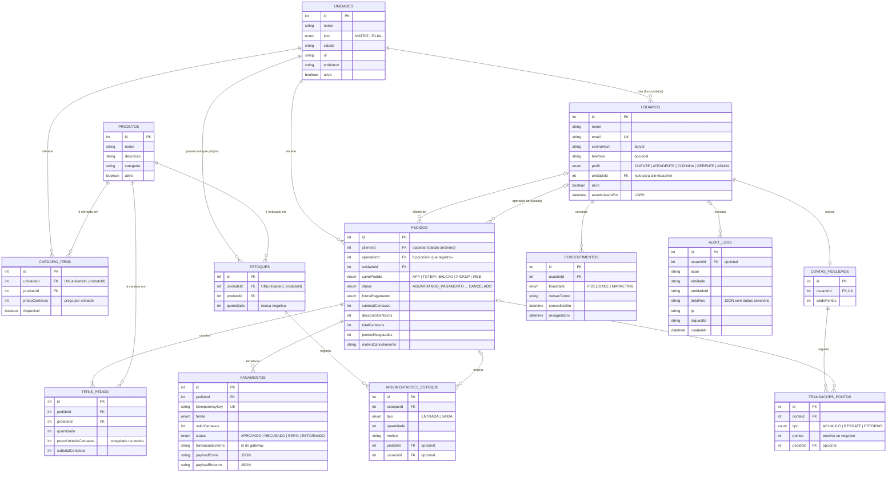

# DER — Modelo de Dados

Banco SQLite, usando o Prisma. O DER é o mesmo do arquivo prisma/schema.prisma.

## Restrições

- Cada unidade tem uma linha de preço e um saldo de estoque por produto (unique em unidadeId + produtoId).
- E-mail único por usuário.
- A Idempotency-Key do pagamento é única, para não cobrar a mesma tentativa duas vezes.
- Cada cliente tem no máximo uma conta de pontos.
- O estoque e o saldo de pontos nunca ficam negativos. Isso é garantido no update, que só baixa se tiver saldo.
- O pagamento fica numa tabela separada do pedido (um pedido pode ter várias tentativas).
- O preço do item fica gravado no pedido, então mudar o cardápio não altera pedidos antigos.
- Valores em centavos (inteiro).
- Índices em pedidos por canal, status e unidade, que são os filtros mais usados.
