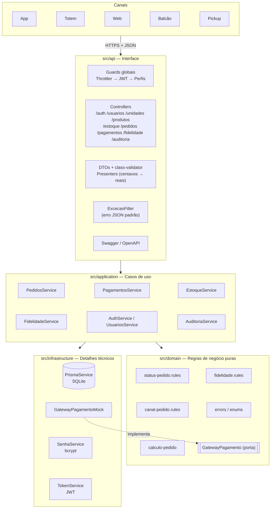

# Arquitetura em camadas

O projeto é dividido em quatro camadas. O domínio não depende de NestJS, HTTP nem Prisma.

- api: controllers, validação dos dados de entrada, autenticação, permissões, Swagger e conversão dos erros para HTTP.
- application: serviços que executam os casos de uso (criar pedido, pagar, mudar status), controlam as transações e gravam a auditoria.
- domain: regras de negócio puras, que dá para testar sem banco (status do pedido, canais, cálculo do pedido, pontos).
- infrastructure: Prisma, o gateway de pagamento simulado, o hash de senha e o JWT.

Algumas decisões:

- O domínio lança erros próprios (RegraNegocioError, NaoEncontradoError etc.) e um filtro na camada api converte esses erros em 409, 404 etc.
- O serviço de pagamento depende de uma interface (GatewayPagamento), e não do mock direto. Para usar um gateway real, bastaria criar outra classe.
- Os serviços usam o Prisma direto, sem uma camada de repositório, para não complicar demais. As regras importantes ficam no domínio e têm testes.
